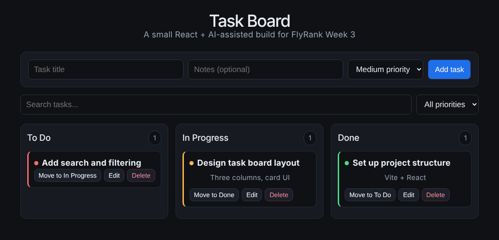

# Task Board — FlyRank Frontend AI Engineering (Week 3)

A Kanban-style task board built in React + Vite as part of the FlyRank AI Front-End AI Engineering internship. The whole implementation was done with an AI assistant, then reviewed and corrected by hand — the process is documented step by step in the [AI development log](AI_DEVELOPMENT_LOG.md).



## Features

- Three columns: **To Do**, **In Progress** and **Done**
- Add, edit and delete tasks, and move them between columns
- Low / medium / high **priority** with colour indicators
- **Search** by title and **filter** by priority
- State saved to `localStorage`, so the board survives a reload

## Built with

`React 19` · `Vite` · `JavaScript` · `CSS` · `oxlint`

## Structure

```text
src/
├── App.jsx              Board state, search and filtering
├── useLocalStorage.js   Persisted state hook
└── components/
    ├── Column.jsx       One status column
    ├── TaskCard.jsx     A single task with its actions
    └── TaskForm.jsx     Add / edit form
```

## Run it locally

```bash
npm install
npm run dev
```

## What I took away

The [AI development log](AI_DEVELOPMENT_LOG.md) records the prompts used, where the generated code needed manual correction, and how the result was verified in a live browser preview.
